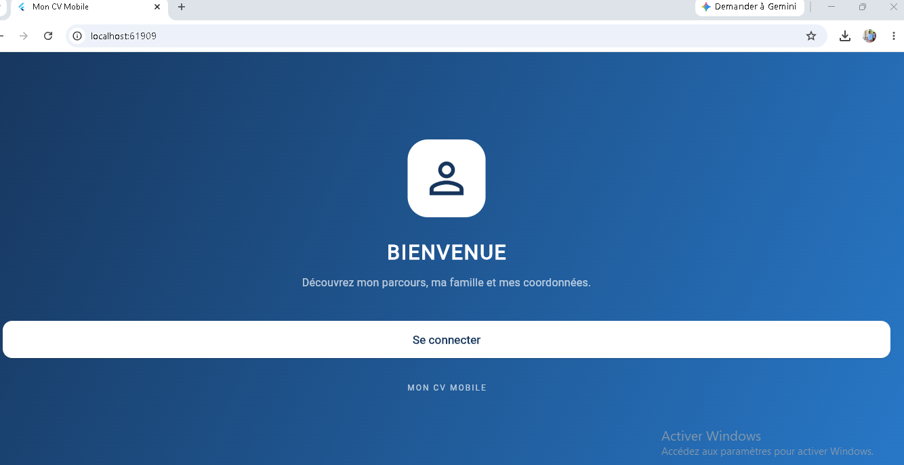
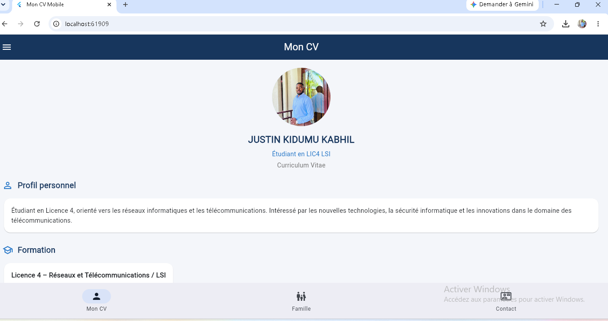
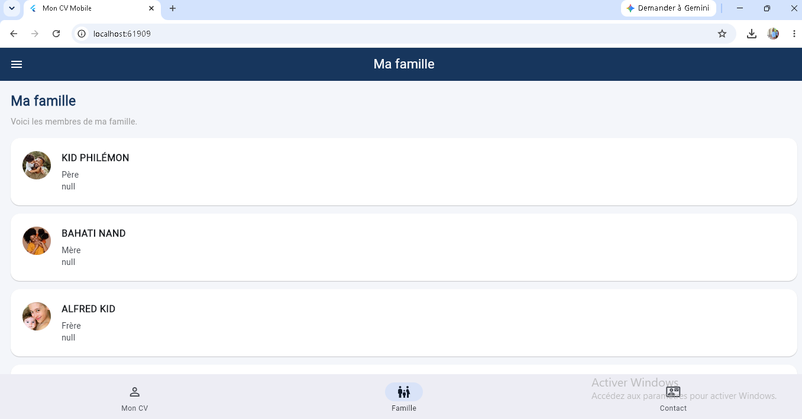
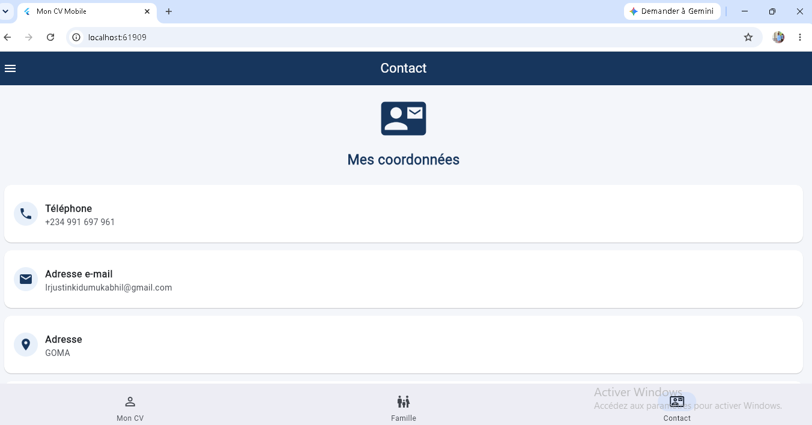

APPLICATION CV FAMILIALE — FLUTTER

Présentation du projet

Cette application mobile a été développée avec Flutter et Dart dans le cadre d’un travail pratique.

Elle présente mon profil personnel, mon parcours académique, ma famille et mes informations de contact.

Fonctionnalités

* Page de connexion
* Présentation de mon CV
* Présentation de ma famille
* Page de contact
* Navigation entre les différentes pages

Technologies utilisées

* Flutter
* Dart
* Visual Studio Code

##Captures d’écran

1. Page de connexion

2. Page d’accueil — CV

3. Page Famille

4. Page Contact

5. La video

Auteur

Justin Kidumu Kabhil

LIC4 — Réseaux et Télécommunications / LSI

ISIG GOMA

Conclusion

Ce projet m’a permis de mettre en pratique mes connaissances en développement d’applications mobiles avec Flutter et Dart.
